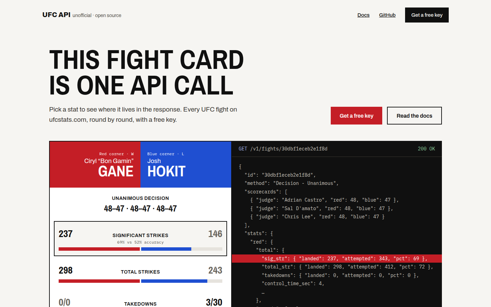

# Unofficial UFC API

**Every UFC round, one request.** A free, open-source REST API with the full depth of
[ufcstats.com](http://ufcstats.com): every event, fight and fighter, stats for each round,
where every strike landed, and judges' scores in the right corner.

[](LICENSE)


**[Website](https://ufc-api.on-forge.com)** · **[Docs](https://ufc-api.on-forge.com/docs)** ·
**[Is it up?](https://ufc-api.on-forge.com/v1/health)** · **[Terms](https://ufc-api.on-forge.com/terms)**

[](https://ufc-api.on-forge.com)

## Try it in 30 seconds

```bash
# 1. Get a free key
curl -X POST https://ufc-api.on-forge.com/v1/register \
  -H 'Content-Type: application/json' \
  -d '{"name":"Jane Dev","email":"jane@example.com","password":"supersecret"}'

# 2. Ask for a fighter
curl "https://ufc-api.on-forge.com/v1/fighters?search=gane" \
  -H 'Authorization: Bearer YOUR_KEY'
```

Free tier: 60 requests a minute. New fights are pulled from ufcstats every day.

## Why this exists

UFC data today comes two ways: detailed **datasets** (big CSV files, no API) or **APIs** that
stop at fighters and rankings. This is both: the full detail of ufcstats, behind a clean API.

- **Round by round.** Strikes, takedowns, knockdowns and control time for each round, not just
  the fight total.
- **Where strikes landed.** Head, body or leg, and from distance, clinch or the ground, every round.
- **Judges' scores in the right corner.** ufcstats lists each score loser first, not by corner.
  Scrapers that read it in order put about half their scorecards in the wrong corner. This API
  matches every score to the fighter it belongs to, checked on unanimous and split decisions.
- **Full fight details.** Referee, how it ended, time format, place on the card, title fights.
- **Same IDs as ufcstats**, so you can always check a record against the source.

Free for anything legal **except gambling**. See [Terms of use](#terms-of-use).

## API

Base path: `/v1`. Responses are JSON. List endpoints are paginated (`data` + `meta` + `links`).

| Method | Endpoint | Description |
|---|---|---|
| `POST` | `/v1/register` | Get a free API key |
| `GET` | `/v1/health` | Is it up, how fresh the data is, and the latest card (public) |
| `GET` | `/v1/events` | List events: `?status= &from= &to= &search= &sort=-date &per_page=` |
| `GET` | `/v1/events/{id}` | Event + its bouts |
| `GET` | `/v1/fighters` | List/search fighters: `?search= &stance= &sort=name` |
| `GET` | `/v1/fighters/{id}` | Fighter profile + career averages |
| `GET` | `/v1/fighters/{id}/fights` | A fighter's bout history |
| `GET` | `/v1/fights` | List fights: `?event_id= &fighter_id= &method= &weight_class= &is_title_bout=` |
| `GET` | `/v1/fights/{id}` | **Full fight**: corners, scorecards, totals + per-round breakdown |

Interactive docs (OpenAPI + "try it out") live at **[/docs](https://ufc-api.on-forge.com/docs)**.

### Authentication

Data endpoints need a free API key (see [Try it in 30 seconds](#try-it-in-30-seconds)). Send it
as a bearer token. Free tier: **60 requests/min** per key; going over returns `429` with the
error envelope.

### Example: `GET /v1/fights/{id}`

```jsonc
{
  "data": {
    "id": "d83294b031502177",
    "event": { "id": "31e1...", "name": "UFC Fight Night: Fiziev vs. Torres", "date": "2026-06-27" },
    "weight_class": "Middleweight", "is_title_bout": false,
    "scheduled_rounds": 3, "time_format": "3 Rnd (5-5-5)",
    "red":  { "fighter": { "id": "...", "name": "Ikram Aliskerov" }, "outcome": "win" },
    "blue": { "fighter": { "id": "...", "name": "Brunno Ferreira" }, "outcome": "loss" },
    "method": "Decision - Unanimous", "method_detail": null,
    "end_round": 3, "end_time": "5:00", "referee": "Marc Goddard",
    "scorecards": [ { "judge": "David Lethaby", "red": 30, "blue": 27 } ],
    "stats": {
      "red": {
        "total":  { "sig_str": {"landed":47,"attempted":98,"pct":48}, "knockdowns":0,
                    "takedowns": {"landed":5,"attempted":6,"pct":83}, "control_time_sec":533,
                    "targets": {"head":{"landed":32,"attempted":80}, "body":{}, "leg":{}},
                    "positions": {"distance":{}, "clinch":{}, "ground":{}} },
        "rounds": [ { "round":1, "sig_str":{}, "targets":{}, "positions":{} } ]
      },
      "blue": { "total": {}, "rounds": [] }
    }
  }
}
```

### Error envelope

All `/v1` errors share one shape:

```json
{ "error": { "code": "not_found", "message": "The requested resource was not found." } }
```

Codes: `validation_error` (422, includes `details`), `unauthenticated` (401), `not_found` (404),
`rate_limited` (429), `server_error` (500).

## Data source & scraping

All data comes from ufcstats.com. The scraper is a single Laravel app (no headless browser):
HTTP via Guzzle + parsing via `symfony/dom-crawler`.

> **Note on the anti-bot challenge.** ufcstats serves a lightweight JavaScript proof-of-work
> challenge. The client solves it server-side (standard SHA-256) and caches the clearance
> cookie. The scraper identifies itself honestly via User-Agent, rate-limits itself, and runs
> at most daily. This is an *unofficial* project, not affiliated with or endorsed by the UFC or
> Zuffa LLC; respect ufcstats.com and use the data responsibly.

```bash
php artisan ufc:scrape                          # incremental: new + upcoming events
php artisan ufc:scrape --all                    # full historical backfill
php artisan ufc:scrape --event={ufcstats_id}    # a single event
php artisan ufc:scrape --fighter={ufcstats_id}  # a single fighter
```

Schedule the daily incremental run in `routes/console.php`:

```php
Schedule::command('ufc:scrape')->dailyAt('09:00');
```

## Local development

Built for [Laravel Herd](https://herd.laravel.com) (bundled PHP 8.3 + MySQL), which auto-serves
the project at `http://ufc-api.test`.

```bash
git clone https://github.com/mostafa-amine/ufc-api.git && cd ufc-api
composer install
cp .env.example .env && php artisan key:generate

# MySQL (Herd ships one on 127.0.0.1:3306, root / no password)
mysql -h127.0.0.1 -uroot -e "CREATE DATABASE ufc_api CHARACTER SET utf8mb4"
php artisan migrate

php artisan ufc:scrape --event=<id>   # pull some data
# open http://ufc-api.test/docs
```

## Testing

```bash
php artisan test
```

Tests run against a MySQL `ufc_api_test` database. Parsers are covered by fixture-based unit
tests (real ufcstats HTML saved under `tests/fixtures/`); the scrape pipeline and API are
covered by feature tests, including a scrape **idempotency** check.

## Architecture

```
app/Scraping/
  UfcStatsClient.php          HTTP + proof-of-work challenge solver
  Parsers/                    EventList, EventDetail, FightDetail, Fighter
  Support/Parse.php           tolerant field parsers
  Actions/                    idempotent upserts (event / fight / fighter)
  ScrapeUfc.php               orchestrator (sync list, scrape event, refresh fighters)
app/Http/
  Controllers/Api/V1/         events / fighters / fights / register / health
  Resources/                  JSON shaping + derived percentages
app/Models/                   Event, Fighter, Fight, RoundStat, Scorecard, ScrapeRun
```

See [`docs/specs/2026-06-27-ufc-api-design.md`](docs/specs/2026-06-27-ufc-api-design.md) for the
full design.

## Terms of use

The hosted API is free for anything legal **except gambling**: no sportsbooks, odds, betting tips,
betting models, prediction markets or paid fantasy contests. Keys used that way are switched off.
Full terms: `/terms` on the hosted site. They cover the hosted API only; the code stays MIT.

## Contributing

Issues and pull requests are welcome, especially parser fixes when ufcstats changes a page.
Run `php artisan test` before opening a pull request.

If this API saves you time, a star on GitHub helps other people find it.

## License

[MIT](LICENSE). Data belongs to its respective owners; this project does not claim ownership of
UFC data and is not affiliated with the UFC.
